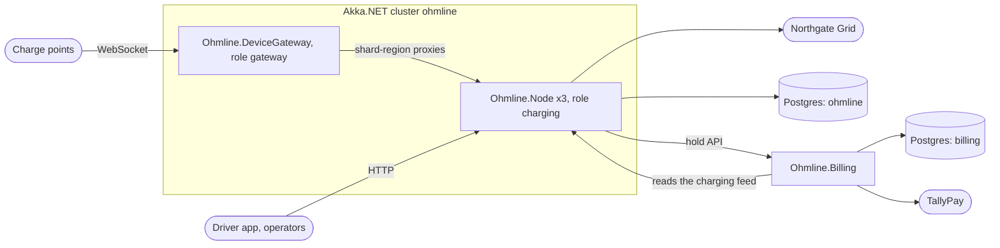

# 0005. One Akka.NET cluster with two roles, and Billing outside it

- **Status:** Accepted
- **Date:** 2026-11-04
- **Book section:** ch05-s07

## Context

Ohmline has six bounded contexts (`docs/context-map.md`). ADR 0004 gives four of them actors
(Charging, Site Energy, Tariffs, Driver Accounts), gives the Device Gateway plain connection
actors, and gives Billing none. Something has to decide which processes they run in, and which
of them share an Akka.NET cluster.

The forces:

- **Charging and the Device Gateway are a Partnership.** Every frame from a charge point becomes
  a command to a Charging aggregate within milliseconds, and remote starts flow back the same
  way. The two teams already release together.
- **Starting a charge crosses four contexts** (Driver Accounts, Billing, Site Energy, Charging)
  in a few seconds. Inside one cluster, each of those steps is a message to a shard region.
  Across clusters, each is an HTTP call or a broker message with its own retries and timeouts.
- **One cluster couples releases.** During a rolling update, old and new nodes exchange messages
  for every context in the cluster, so every context's messages must stay readable across
  adjacent versions (section 21.7). A cluster is also one failure domain: a split brain or a
  journal outage affects every context in it.
- **A shared cluster invites shortcuts.** When any actor can reach any other, a context starts to
  `Tell` another context's internal actors, and a deploy of one breaks the other at run time.
  That is a distributed Big Ball of Mud: the mess of a monolith, with network failures added.
- **Billing is different on purpose.** It has no actors and keeps its state in its own database,
  it is owned by Finance IT on its own release cycle, and it talks to a payment provider whose
  slowness must not reach the cluster.

The options were a cluster per context, one cluster for everything, and one cluster with roles
for the actor contexts plus Billing as an ordinary service. A cluster per context isolates best,
but turns every step of the charging journey into a remote call between clusters, for a
company with five small teams. One cluster for everything would put a service with no actors
into an actor system for no benefit.

## Decision

We will run **one Akka.NET cluster, `ohmline`**, which is also the `ActorSystem` name on every
node, with two roles:

| Role | Host | Runs |
|---|---|---|
| `charging` | `Ohmline.Node` | Charging, Site Energy, Tariffs and Driver Accounts: every shard region, the `tariff-book` singleton, the projections |
| `gateway` | `Ohmline.DeviceGateway` | One connection actor per charge point, and shard-region proxies to `charge-point`, `charging-session` and `charging-journey`. It hosts no entities |

We will run **Billing as a separate web service, `Ohmline.Billing`**, with no `ActorSystem` and
its own database (`billing`). Charging reaches it through its hold API over HTTP; Billing reads
Charging's feed over HTTP.

Inside the cluster, contexts meet only through their `Contracts`: a context sends another
context's commands to that context's shard region, singleton proxy or shard-region proxy,
obtained from the actor registry. No context holds an `IActorRef` to, or an actor path into,
another context's actors, and no `*.Actors` project references another context's `Actors` or
`Domain` project.

The charge points connect only to gateway nodes. Gateway nodes forward through shard-region
proxies, so the entities always live on `charging` nodes. The journal and the read models share
the `ohmline` database; Billing's state is in a database of its own, and it reaches the cluster
only through HTTP, in both directions. The grid operator ACL's poller runs on the `charging`
nodes and polls Northgate Grid.

## Consequences

- The charging journey's steps are in-cluster messages: no extra broker, no HTTP between the
  actor contexts, and location transparency for every aggregate.
- Gateway nodes scale with the number of connected charge points, `charging` nodes with the
  number of entities and sessions, independently.
- **Every context in the cluster shares its rolling updates.** All of their messages need
  manifests and golden files from the start (section 10.3), and a release must read the previous
  release's messages (sections 20.2 and 21.7). We accept this coupling for the four actor
  contexts because the Partnership and the journey already couple them.
- **Billing fails separately.** A slow TallyPay or a Billing deploy delays settlement, not
  charging; the journey waits, retries and compensates (Chapter 15). Billing's integration is
  plain HTTP with idempotency keys and its own contract tests (section 16.10).
- **The distributed Big Ball of Mud is the risk this ADR accepts and guards against.** The
  guards: contexts exchange only `Contracts` types; each context has its own serializer id and
  manifest prefix (`docs/naming-rules.md`); `ContextBoundaryTests` in
  `tests/Ohmline.ArchitectureTests` fail when a project in one context references anything of
  another context except its `Contracts`; and `.github/CODEOWNERS` makes every contract change
  visible to the teams that read it.
- **When to split.** If one context's release cadence or load stops matching the others, its
  first step is a role of its own on its own nodes. If it then needs independent releases, it
  moves to a cluster or service of its own and talks to the rest through its Published Language,
  as Billing already does. That would be a new ADR superseding this one.
- Kubernetes (section 21.6) runs one Deployment per role and one for Billing; the AppHost
  (section 12.10) does the same on a laptop.

## References

- Eric Evans, *Domain-Driven Design Reference*, 2015, "Bounded Context", "Context Map" and
  "Partnership", https://domainlanguage.com/wp-content/uploads/2016/05/DDD_Reference_2015-03.pdf
- Akka.NET documentation, "Cluster Sharding" (roles and shard-region proxies),
  https://getakka.net/articles/clustering/cluster-sharding.html
- Vlad Khononov, *Learning Domain-Driven Design*, O'Reilly, 2021, chapter 14 (microservices and
  the distributed big ball of mud).
