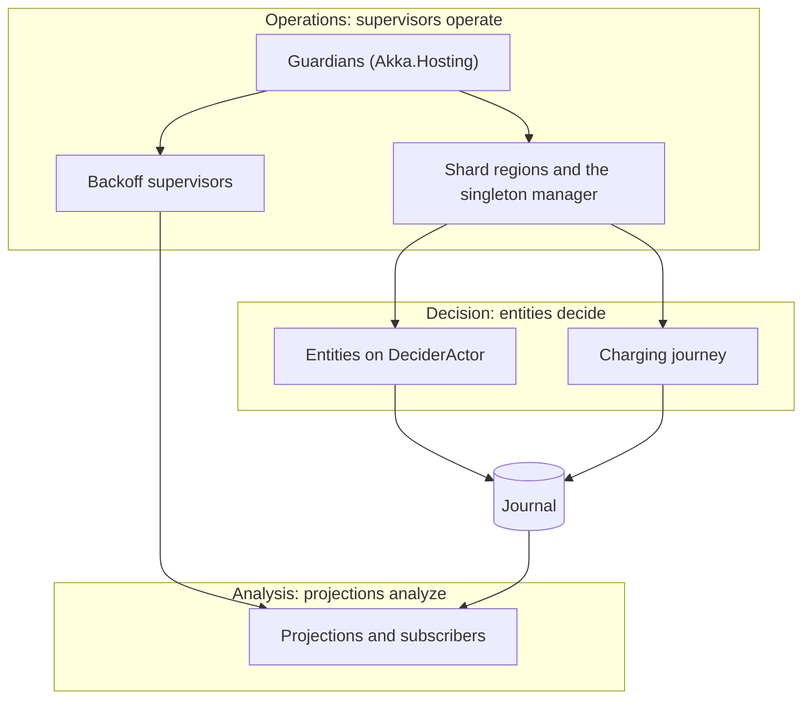

# 0006. Responsibility layers in the actor hierarchy, and how supervision is used

- **Status:** Accepted
- **Date:** 2026-11-04
- **Book section:** ch05-s09

## Context

Every Akka.NET system is a tree of actors, and every parent supervises its children. Nothing in
Akka.NET says what the levels of that tree should mean. Left alone, the tree grows in two bad
directions: supervisors start to make business decisions ("if the allocation failed, restart
the session with less power"), and hierarchies get deep, with a parent per site, per charge
point and per connector pretending to be aggregates. Both make failures hard to reason about and
rules hard to find.

Eric Evans's large-scale structure patterns address the same problem for a whole model:
Evolving Order, System Metaphor, Responsibility Layers, Knowledge Level and Pluggable Component
Framework. They are the least practised part of Domain-Driven Design; most teams, and most later
books, skip them. We use them lightly here: as shared vocabulary and as rules for code review,
not as frameworks.

## Decision

### Responsibility layers

We will give the actor hierarchy three responsibility layers. Each layer depends only on the
layer below it, and only through messages and events.

| Layer | Responsibility | Actors | Never does |
|---|---|---|---|
| **Operations** ("supervisors operate") | Keep things running: start, restart with backoff, passivate, hand over shards, shut down | Akka.Hosting's guardians, shard regions and the singleton manager, backoff supervisors for pollers and projections, coordinated shutdown | Decide anything a domain expert would recognise |
| **Decision** ("entities decide") | Make every business decision, through a pure decider | Entities on `DeciderActor`: charge point, session, site power budget, id token, tariff book; the charging journey | Supervise other entities, or query read models to decide |
| **Analysis** ("projections analyze") | Look at decisions after they were made: read models, live updates, the integration relay, metrics | Projections and event subscribers in each context's `ReadModels` project | Change a decision, or `Tell` an entity anything but a command a policy produced |

Arrows from the operations layer are supervision: a parent starts and restarts its children.
Decisions reach the analysis layer only through the journal, never by a direct message, so a
projection can be stopped, rebuilt or added without an entity noticing.

### Supervision rules

- **The tree is shallow.** Guardian, shard region, shard, entity: that is as deep as an
  aggregate goes. No custom supervisor sits between a region and its entities, and entities have
  no child actors.
- **Domain errors are replies, not exceptions** (ADR 0002). A supervisor only ever sees
  infrastructure failures, and its strategy never encodes a business rule.
- **What fails, and what happens then:**

  | Actor | On failure | Section |
  |---|---|---|
  | Persistent entity | Stops when the journal fails; the next message to its shard region starts it again from the journal | 11.6, 12.4 |
  | Projection | Restarts with backoff from its stored offset | 13.4, 13.7 |
  | Grid signal poller | Restarts with backoff under a backoff supervisor | 16.8 |
  | Charge point connection | Stops; the charge point reconnects on its own | 16.7 |
  | Charging journey | Like any entity; remember-entities restarts it after a shard moves | 15.3 |

### The other large-scale structures

- **Evolving Order.** This structure is a current best guess, not a law. We add a layer or a
  rule when the code needs it and record it in an ADR that supersedes this one, rather than
  designing the whole hierarchy up front.
- **System Metaphor: "the grid".** Ohmline talks about each site as a small electrical grid:
  the grid connection is the substation's capacity, sessions are loads, allocations are
  dispatch, a curtailment is a grid emergency and a charging profile is a setpoint. The metaphor
  helps new people reason about Site Energy. Its limit: it never replaces a glossary word in
  code, and power does not flow like messages.
- **Knowledge Level.** Tariffs and site configurations are policies held as data, edited by
  people (the pricing analyst, the asset team) and read by the decision layer as parameters:
  a session copies a tariff snapshot, the site power budget holds its site configuration. A new
  price or a new site never needs new code (sections 6.7, 8.2 and 12.8).
- **Pluggable Component Framework.** Charger vendors differ in small ways (energy in Wh or kWh,
  status names, optional fields). The Device Gateway's translator handles them as per-vendor
  rules behind one interface, chosen from the boot notification, so adding a vendor means adding
  its rules and recorded frames, not changing the translator (section 16.6). This is the only
  place in Ohmline where a plug-in structure pays for itself.

## Consequences

- A reviewer can ask of any new actor: which layer is it in, and does it only look down? An
  actor that both decides and supervises, or a projection that sends commands it did not get
  from a policy, is redesigned before it is merged.
- Business rules stay in deciders, where the tests of Chapter 9 can reach them; supervision
  strategies stay short and boring.
- Projections can be rebuilt, versioned and added freely (Chapters 13 and 20), because the
  decision layer does not know they exist.
- The large-scale structures cost little because they are mostly vocabulary. If one of them
  stops paying for itself, we drop it and record that here.

## References

- Eric Evans, *Domain-Driven Design Reference*, 2015, Part VI "Large-scale Structure for
  Strategic Design",
  https://domainlanguage.com/wp-content/uploads/2016/05/DDD_Reference_2015-03.pdf
- Eric Evans, *Domain-Driven Design*, Addison-Wesley, 2003, chapter 16.
- Akka.NET documentation, "Supervision and Monitoring",
  https://getakka.net/articles/concepts/supervision.html
