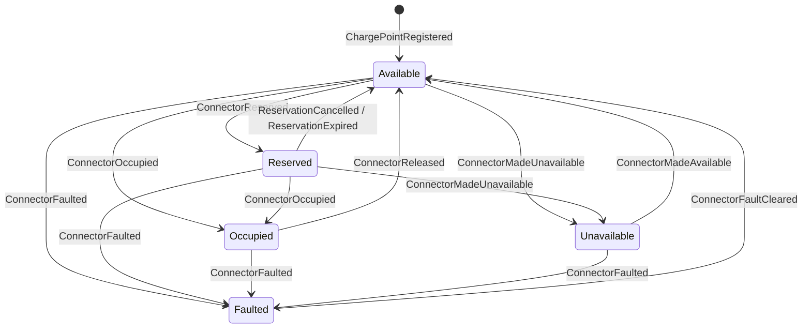

# Aggregate Design Canvas: Charge point

*Aggregate Design Canvas (ddd-crew), filled in during section 7.1. The canvases for the other
aggregates are in this folder; `docs/eventstorming/design-level.md` is where the aggregate was
found.*

## Name

**Charge point** (`ChargePoint`, shard type name `charge-point`, keyed by `ChargePointId`, such as
`OHM-SLC-0042`)

## Description

One physical charge point and its numbered connectors, as Charging sees them: which connector is
available, reserved, occupied, faulted or taken out of use. It decides who may use a connector
next. It knows nothing about energy, prices or power budgets.

## State transitions

Each connector moves through its own states; the charge point holds all of them.

Before `ChargePointRegistered` the charge point does not exist for Ohmline (`Unregistered`), and
every command except `RegisterChargePoint` is refused.

## Enforced invariants

1. A connector hosts at most one session at a time.
2. A reserved connector accepts only the token that holds the reservation, until the reservation
   expires. An expired reservation no longer protects the connector, even before the timer that
   expires it has fired.
3. A faulted connector accepts no reservation and no session until the fault is cleared.
4. A connector that operators took out of use accepts no reservation and no session.
5. A charge point is registered once.

All five rules need only the charge point's own state. Rule 1 is why the charge point, not the
connector, is the aggregate (section 6.6): a connector is an entity inside it, so "occupy" and
"reserve" for one connector are decided one at a time by one decider.

## Corrective policies

- **Whenever a reservation's time is up, then expire it.** An actor timer sends
  `ExpireReservation` (section 11.4). The decider checks the time again, so an early or stale
  timer changes nothing.
- **A fault ends charging, not the session's history.** `ConnectorFaulted` on an occupied
  connector frees the connector; the charging session hears about it from the Device Gateway and
  ends itself. The two aggregates are never updated together (Vernon's rule 4).

## Handled commands

| Command | From | Accepted when |
|---|---|---|
| `RegisterChargePoint` | Operators, the AssetTrack import | Not yet registered |
| `ReserveConnector` | Driver app | Available, or reserved by the same token (no change), or reserved by a token whose reservation has expired |
| `CancelReservation` | Driver app | Reserved by the same token; anything else that holds no reservation is a no-op |
| `ExpireReservation` | Timer (section 11.4) | Reserved and the expiry time has passed; otherwise a no-op |
| `OccupyConnector` | Device Gateway | Available, reserved by the same token, or reserved by a token whose reservation has expired |
| `ReleaseConnector` | Device Gateway | Occupied; otherwise a no-op |
| `ReportConnectorFault` | Device Gateway | Not already faulted |
| `ClearConnectorFault` | Device Gateway, technicians | Faulted; otherwise a no-op |
| `MakeConnectorUnavailable` | Operators | Available or reserved; refused while occupied or faulted |
| `MakeConnectorAvailable` | Operators | Unavailable; refused while faulted |

## Created events

`ChargePointRegistered`, `ConnectorReserved`, `ReservationCancelled`, `ReservationExpired`,
`ConnectorOccupied`, `ConnectorReleased`, `ConnectorFaulted`, `ConnectorFaultCleared`,
`ConnectorMadeUnavailable`, `ConnectorMadeAvailable`.

## Throughput

Throughput is the rate at which commands reach one aggregate instance. In the actor shell it is
the **mailbox rate** of one entity actor: commands for one charge point are handled one at a time,
so this number says whether one mailbox can keep up.

| Question | Estimate |
|---|---|
| Command handling rate, average | About 30 commands a day per charge point (two connectors, 8 to 12 sessions each, a few reservations) |
| Command handling rate, peak | A few commands a minute: a plug-in, a reservation and a status change arriving together |
| Clients | One Device Gateway connection, the driver app (through the HTTP edge), one timer |
| Concurrency conflict chance | Low but real: a driver reserving in the app while someone else plugs in. The mailbox orders them; the decision table decides who wins |

## Size

Size is the number of events one instance accumulates. It is what recovery replays, so it sets
the **snapshot cadence** (section 11.2).

| Question | Estimate |
|---|---|
| Event growth rate | About 30 events a day per charge point |
| Lifetime of one instance | Years: as long as the charge point is installed |
| Events persisted | About 10,000 a year |
| Snapshot cadence | Every 100 events (the shell's default), about every three days. Recovery then replays at most 100 events, whatever the charge point's age |

## Vernon's four rules

| Rule | Here |
|---|---|
| Protect true invariants in consistency boundaries | The five rules above, all inside one charge point |
| Design small aggregates | Two to four connectors and their current states; no sessions, no history in memory |
| Reference other aggregates by identity | A `SiteId` for its site, a `SessionId` and a `TokenUid` for whoever occupies or reserves a connector. Never an `IActorRef` |
| Use eventual consistency outside the boundary | The session, the site power budget and the id token learn about connector changes through events and the charging journey (Chapter 15) |
