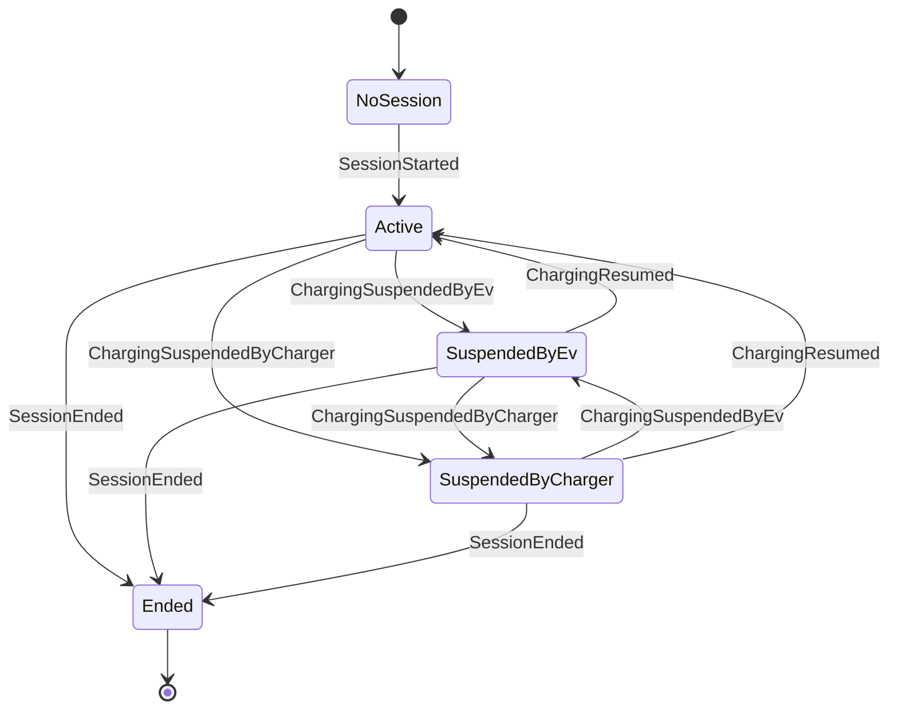

# Aggregate Design Canvas: Charging session

*Aggregate Design Canvas (ddd-crew), filled in during section 7.1.*

## Name

**Charging session** (`ChargingSession`, shard type name `charging-session`, keyed by
`SessionId`, a version 7 Guid)

## Description

One charge on one connector, from start to end: the meter readings, when charging was suspended,
the tariff locked at the start and the driver's spend cap. It turns what the charge point reports
into facts that can be priced. It does not decide whether the connector may be used (the charge
point does) or how much power flows (the site power budget does).

## State transitions

`MeterValueRecorded`, `MeterAnomalyDetected` and `SpendCapReached` keep a session in its current
state. The state of a running session is called `Active`, not `Charging`: a type named `Charging`
would collide with the namespace `Ohmline.Charging` everywhere outside its own namespace (the
same trap as `Money` in section 6.3).

## Enforced invariants

1. Meter registers never go backwards. The energy delivered is the latest accepted register minus
   the register at the start.
2. The tariff is locked when the session starts; nothing later changes it (hotspot H9).
3. The spend cap is a positive amount in the tariff's currency.
4. A session starts once and ends once.

## Facts the session cannot refuse

The charge point reports what happened; a session cannot send electricity back. So a meter reading
that breaks rule 1 is **recorded as `MeterAnomalyDetected`, not rejected** (hotspot H4): the
reading is kept for people to investigate, and the energy delivered keeps counting from the last
good reading. Likewise, reaching the spend cap is not a rejection but a fact,
`SpendCapReached`, recorded in the same decision as the meter value that crossed it.

## Corrective policies

- **Whenever the spend cap is reached, then stop charging** (`SpendCapPolicy`, section 8.5). The
  session records the fact; stopping the charger is someone else's job.
- **Whenever a session ends, then release its power allocation and unlock its token**
  (`ReleaseOnSessionEnded`, sections 8.5 and 15.1).
- **Whenever charging is suspended, then warn the driver when the idle fee starts**
  (`IdleFeePolicy`, section 8.5), only if the session's tariff has an idle fee.

## Handled commands

| Command | From | Accepted when |
|---|---|---|
| `StartSession` | Charging journey | No session yet, with a valid spend cap |
| `RecordMeterValue` | Device Gateway | Active or suspended; a duplicate of the latest reading or a late reading after the end changes nothing |
| `SuspendCharging` | Device Gateway | Active, or suspended by the other side (the latest report says who); suspended again by the same side is a no-op |
| `ResumeCharging` | Device Gateway | Suspended; already active is a no-op |
| `StopSession` | Device Gateway, charging journey | Active or suspended; **already ended is a no-op**, so a repeated stop is harmless |

## Created events

`SessionStarted`, `MeterValueRecorded`, `MeterAnomalyDetected`, `ChargingSuspendedByEv`,
`ChargingSuspendedByCharger`, `ChargingResumed`, `SpendCapReached`, `SessionEnded`.

## Throughput

| Question | Estimate |
|---|---|
| Command handling rate, average | One meter value a minute while the session runs |
| Command handling rate, peak | A burst of a few hundred meter values when a charge point that was offline reconnects and sends what it buffered |
| Clients | One Device Gateway connection, one charging journey |
| Concurrency conflict chance | Very low: one charger and one journey talk to one session |

The mailbox rate is low and steady. Keeping sessions out of the charge point is what keeps it
that way: inside the charge point, every meter value would queue behind reservations and plug-ins
for the other connectors.

## Size

| Question | Estimate |
|---|---|
| Event growth rate | About 60 events an hour |
| Lifetime of one instance | Typically one or two hours; an overnight fleet charge lasts ten |
| Events persisted | 60 to 600 per session, then none: an ended session never changes |
| Snapshot cadence | Every 100 events (the default): a long session recovers from a snapshot and fewer than 100 events. Most sessions end before they need many |

## Vernon's four rules

| Rule | Here |
|---|---|
| Protect true invariants in consistency boundaries | Monotonic meters, the locked tariff and the spend cap need only the session's own history |
| Design small aggregates | The first and latest readings, the locked terms and the state; not every reading in memory |
| Reference other aggregates by identity | `ConnectorId`, `SiteId`, `TokenUid` and the tariff's id and version |
| Use eventual consistency outside the boundary | The site power budget and the id token are updated by policies after `SessionEnded`, never in the same decision |
