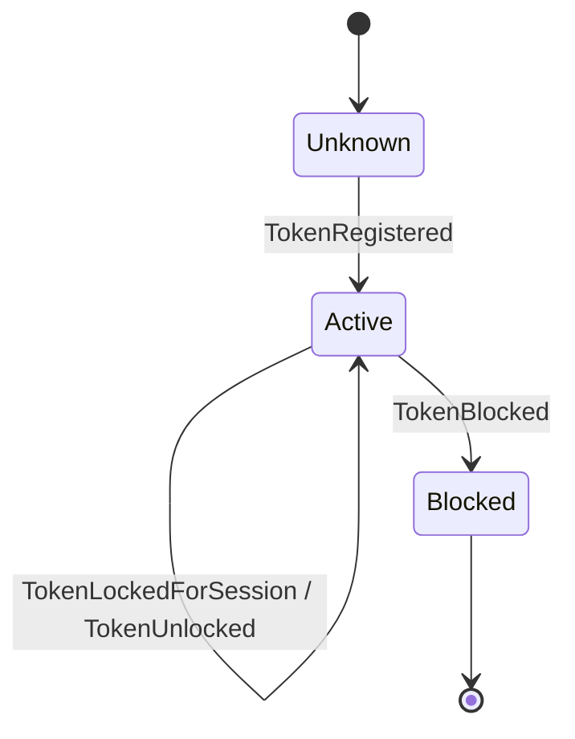

# Aggregate Design Canvas: Id token

*Aggregate Design Canvas (ddd-crew), filled in during section 7.1. The code arrives in section
12.7.*

## Name

**Id token** (`IdToken`, shard type name `id-token`, keyed by `TokenUid`, such as
`04A2B3C4D5E6F7`)

## Description

One RFID card or app credential: which account it belongs to, whether it is blocked, and which
session, if any, it is charging right now. It answers one question quickly while the driver
watches the charge point's display: may this token start a session here, now?

## State transitions

`Active` carries the active session, if there is one.

## Enforced invariants

1. A token belongs to one account.
2. A token has at most one active session (hotspot H7: the same card tapped at two sites within a
   minute).
3. A blocked token starts no session.

Rule 2 looks like a rule about sessions, but it is a rule about the token. Keying an aggregate on
the token UID turns a uniqueness check across every session in Ohmline into a local check in one
small aggregate (section 12.7 discusses the alternatives).

## Corrective policies

- **Whenever a session ends, then unlock its token** (`ReleaseOnSessionEnded`, sections 8.5 and
  15.1).
- **Whenever a lock is never released** (a lost `SessionEnded`), operators can unlock the token;
  the charging journey's timeout reports it (Chapter 15).

## Handled commands

| Command | From | Accepted when |
|---|---|---|
| `RegisterToken` | Driver Accounts (HTTP) | Unknown |
| `BlockToken` | Operators, fraud checks | Registered |
| `LockForSession` | Charging journey | Active and not locked; the same session locking twice is a no-op |
| `UnlockFromSession` | Charging (policy) | Locked by that session; anything else is a no-op |

## Created events

`TokenRegistered`, `TokenBlocked`, `TokenLockedForSession`, `TokenUnlocked`.

## Throughput

| Question | Estimate |
|---|---|
| Command handling rate, average | Two to four commands a day for a driver's card |
| Command handling rate, peak | Two taps within a minute (hotspot H7) |
| Clients | Charging journeys anywhere in the network, the release policy |
| Concurrency conflict chance | Rare, and exactly the case the aggregate exists for: two journeys asking to lock one token. The mailbox puts them in order and the second is refused |

## Size

| Question | Estimate |
|---|---|
| Event growth rate | Two events per session the token starts |
| Lifetime of one instance | Years: as long as the card is in use |
| Events persisted | A few hundred a year |
| Snapshot cadence | Every 100 events (the default), about every two months for a daily driver. Recovery is never the bottleneck |

## Vernon's four rules

| Rule | Here |
|---|---|
| Protect true invariants in consistency boundaries | One active session per token, decided by the token alone |
| Design small aggregates | The account reference, a blocked flag and at most one session id |
| Reference other aggregates by identity | A `SessionId` for the active session; the account by an opaque driver reference, never by name |
| Use eventual consistency outside the boundary | The session and the token are separate aggregates: locking the token is one step of the charging journey, unlocking it a reaction to `SessionEnded` |
