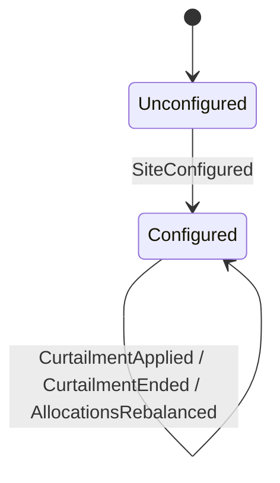

# Aggregate Design Canvas: Site power budget

*Aggregate Design Canvas (ddd-crew), filled in during section 7.1. Site Energy's Highlighted Core
(`docs/highlighted-core.md`).*

## Name

**Site power budget** (`SitePowerBudget`, shard type name `site-power-budget`, keyed by `SiteId`,
such as `slc-depot`)

## Description

The share of one site's grid connection that each charging connector may draw. It turns requests
for power into allocations that keep the site within its effective capacity, serves fleet
connectors before public ones, and recomputes every allocation whenever something changes.

## State transitions

The interesting state is inside `Configured`: every open request, in arrival order, and the
current allocation of each request that was admitted.

## Enforced invariants

1. **The sum of all allocations never exceeds the effective capacity**: the grid connection
   limit minus the active curtailment minus the safety margin.
2. Each allocation stays within its connector's minimum and maximum power, and never above what
   the request asked for.
3. Fleet requests are served before public ones; within a priority class, requests are served in
   the order they arrived, and none overtakes an earlier one that is still waiting.
4. A connector has at most one open request.

Rule 1 spans every connector at the site, which is why the budget is one aggregate per site and
cannot be split by charge point.

## Corrective policies

- **Whenever capacity drops below what is allocated, then rebalance.** A curtailment can leave
  admitted requests without room; the rebalance takes power away (`AllocationsRebalanced`) and
  queues the requests that no longer fit at their minimum, instead of refusing the curtailment.
- **Whenever a session ends, then release its allocation** (`ReleaseOnSessionEnded`, Charging,
  sections 8.5 and 15.1). A release that arrives twice changes nothing.

## Handled commands

| Command | From | Accepted when |
|---|---|---|
| `ConfigureSite` | AssetTrack import, operators | Unconfigured, and the configuration is valid |
| `RequestAllocation` | Charging journey | Configured, the connector belongs to the site and has no other open request |
| `ReleaseAllocation` | Charging (policy) | Configured; releasing a request that is not open is a no-op |
| `ApplyCurtailment` | Grid operator ACL (section 16.8) | Configured; a new curtailment replaces the active one |
| `EndCurtailment` | Grid operator ACL | Configured; without an active curtailment it is a no-op |

## Created events

`SiteConfigured`, `AllocationGranted`, `AllocationQueued`, `AllocationsRebalanced`,
`AllocationReleased`, `CurtailmentApplied`, `CurtailmentEnded`.

## Throughput

| Question | Estimate |
|---|---|
| Command handling rate, average | Two commands per session at the site (request and release), plus a few curtailments a day |
| Command handling rate, peak | At the bus depot's shift change, dozens of buses plug in within minutes: tens of requests a minute, each followed by a rebalance of every allocation at the site |
| Clients | Every charging journey at the site, the release policy, the grid operator ACL |
| Concurrency conflict chance | High: every request at the site competes for the same capacity. The single mailbox is exactly what makes the competition safe |

This is Ohmline's **hot aggregate**. The cost of one command grows with the number of open requests
(the allocator looks at all of them), and the commands of a whole site share one mailbox. At a
public car park with a dozen connectors that is nothing; at the bus depot it is the first thing to
measure. Section 15.8 measures it and discusses splitting by feeder or transformer.

## Size

| Question | Estimate |
|---|---|
| Event growth rate | Three to four events per session at the site, plus two per curtailment; at the depot, a few thousand a day |
| Lifetime of one instance | Years: as long as the site exists |
| Events persisted | Tens of thousands a year at a busy site; `AllocationsRebalanced` carries the whole allocation table, so events grow with the number of open requests |
| Snapshot cadence | Every 100 events (the default) at most; at the depot, consider a smaller interval once section 11.2's measurement shows the replay cost |

## Vernon's four rules

| Rule | Here |
|---|---|
| Protect true invariants in consistency boundaries | Rule 1 is the site's legal and physical limit; it must hold after every single decision |
| Design small aggregates | As small as the invariant allows: one site, its open requests and current allocations; no session details, no history |
| Reference other aggregates by identity | `ConnectorId` and `SessionId` in requests and allocations; Charging's aggregates are never referenced any other way |
| Use eventual consistency outside the boundary | A session and its allocation are separate: the session does not wait for the budget, and the budget learns that a session ended from an event |
