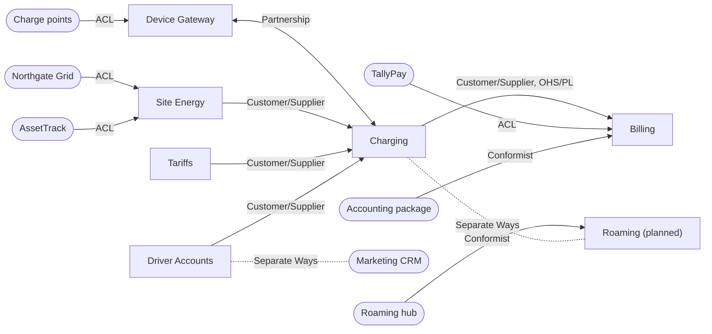

# Ohmline's context map

The canvases in `docs/canvases/` describe each bounded context on its own. This page describes
how they relate: who depends on whom, which team has to adapt when the other changes, and which
context-mapping pattern each relationship follows. It was drawn in a context-mapping workshop in
section 5.4 and is kept current whenever a relationship changes.

## The workshop

| | |
|---|---|
| Who was in the room | One person from each team below, the head of operations, a facilitator |
| Brought along | The six canvases, the Big Picture EventStorming wall, ADR 0004 |
| Time | Two hours |

The group worked in four passes:

1. **Contexts.** One sticky per bounded context from the canvases, and one per external system
   that any canvas mentions.
2. **Flows.** One arrow per message family in the canvases' inbound and outbound tables. An
   arrow points from the context that owns a message's meaning to the one that has to
   understand it.
3. **Teams.** For each pair of contexts joined by an arrow: if one team's plans changed, would
   the other team's work fail? The answer is the team relationship.
4. **Patterns.** For each relationship, the pattern that describes how the two models meet
   today, not how anyone wishes they met.

## Teams

| Team | Owns | Notes |
|---|---|---|
| Sessions | Charging | The largest team; owns the charging journey |
| Gateway | Device Gateway | Two developers who know every charger vendor's firmware |
| Energy | Site Energy | Works with the grid engineers |
| Pricing and Accounts | Tariffs, Driver Accounts | Works with the pricing analyst and support |
| Finance IT | Billing | Reports to the finance director, not to engineering |

Outside Ohmline: TallyPay (payments), Northgate Grid (grid operator), the AssetTrack vendor, the
charger vendors, the roaming hub, the marketing agency's CRM and the accounting package.

## The map

Arrows point downstream: from the context whose model the other has to accept or translate.
Labels name the pattern. A two-headed arrow is a partnership; a dotted line without an arrow
means the two sides do not integrate.

Rounded boxes are systems Ohmline does not own. The shared kernel is not drawn: every context
uses it, and an edge from each context would hide everything else (it is the first row of the
table below). Billing's hold API also flows the other way, from Billing to Charging, and is a
row of its own in the table.

## Relationships

The team relationship comes first, because it decides which patterns are possible:

- **Mutually dependent:** both teams have to deliver for either to succeed. They plan together.
- **Upstream/downstream:** the upstream team's decisions affect the downstream team's success,
  but not the other way round. The downstream team either gets a say (Customer/Supplier),
  accepts what it is given (Conformist) or protects itself (Anticorruption Layer).
- **Free:** a change in one does not affect the other at all.

| Upstream | Downstream | Team relationship | Pattern | What flows | Section |
|---|---|---|---|---|---|
| All contexts | All contexts | Mutually dependent | Shared Kernel | Units, money, cross-context identifiers (`Ohmline.SharedKernel`) | 5.5 |
| Device Gateway | Charging | Mutually dependent | Partnership | Charge point state, sessions and meter values in; remote start, remote stop and charging profiles out | 5.4 |
| Site Energy | Charging | Upstream/downstream | Customer/Supplier | Allocation requests and their answers; rebalanced allocations | 5.4 |
| Tariffs | Charging | Upstream/downstream | Customer/Supplier | The tariff snapshot a session copies | 5.4 |
| Driver Accounts | Charging | Upstream/downstream | Customer/Supplier | Token locks and refusals | 5.4 |
| Charging | Billing | Upstream/downstream | Customer/Supplier; Open Host Service with a Published Language | `SessionCompleted` on the charging feed | 5.4, 5.5 |
| Billing | Charging | Upstream/downstream | Customer/Supplier | The hold API: place hold, capture payment, void hold | 5.4 |
| Charge points (vendor firmware) | Device Gateway | Upstream/downstream | Anticorruption Layer around a Big Ball of Mud | Protocol frames with vendor quirks | 5.6 |
| Northgate Grid | Site Energy | Upstream/downstream | Anticorruption Layer | Demand-response signals | 5.6 |
| AssetTrack | Site Energy | Upstream/downstream | Anticorruption Layer around a Big Ball of Mud | The site and connector export | 5.6 |
| TallyPay | Billing | Upstream/downstream | Anticorruption Layer | Pre-authorizations, captures, voids | 5.6 |
| Accounting package | Billing | Upstream/downstream | Conformist | Billing writes the package's import format as it is | 5.4 |
| Roaming hub | Roaming (planned) | Upstream/downstream | Conformist | The hub's sessions and charge detail records | 5.4 |
| — | Charging, Roaming | Free | Separate Ways | Nothing, in the first release | 5.6 |
| — | Driver Accounts, Marketing CRM | Free | Separate Ways | Nothing | 5.6 |

## Why these patterns

**Partnership: Charging and the Device Gateway.** Neither is useful without the other: a session
starts only when a charge point says so, and a charge point is useful only if a session follows.
New charger features (a new status, a new meter measurand) need changes on both sides in the
same release. The two teams share a planning meeting and a release train, and the gateway
translates directly into Charging's commands rather than into a model of its own. The price is
coordination: neither team can ship a protocol change alone.

**Customer/Supplier: Charging upstream of Billing.** Billing needs to know when a session is
settled and what it cost; Charging decides what a session is. Billing is the customer: its
needs (the session id, the price breakdown, the token) go onto Charging's backlog, and Charging
promises not to break the event Billing reads. The reverse flow, the hold API, is
Customer/Supplier the other way round: Finance IT owns the API and the Sessions team asks for
what the charging journey needs, such as idempotency keys.

**Customer/Supplier: Site Energy, Tariffs and Driver Accounts upstream of Charging.** Each owns a
rule Charging must respect (a power allocation, a price, a token lock), and each answers
Charging's requests in its own language. Charging is the customer whose needs shape their
contracts.

**Conformist: the roaming hub.** Roaming lets drivers from other operators charge at Ohmline
sites. The hub has hundreds of members and will not change its protocol for one of them, and
its model is good enough. When Ohmline builds its Roaming context, that context adopts the hub's
model as it is, sessions and charge detail records included. That is why "session" at the hub
is not Charging's session: Roaming will speak the hub's language, and translate to Charging's at
its own boundary. The accounting package is the same kind of relationship for Billing: it reads
one import format, and Billing writes that format.

**Anticorruption layers.** Where the upstream model is one Ohmline must not let in, the
downstream context translates at its edge: AssetTrack's export (`docs/acl/assettrack.md`),
Northgate Grid's demand-response signals, TallyPay's payment API and the charger vendors'
firmware dialects. Two of these upstreams are Big Balls of Mud: AssetTrack, and the charge points
taken together. Neither can be fixed from inside Ohmline, so both are quarantined behind a pure
translator, and their words never appear in Site Energy's or Charging's model.

**Separate Ways.** Some integrations cost more than they are worth:

- **The marketing CRM.** Marketing would like to know who charges where. Driver Accounts would
  have to send personal data to a system run by an agency, and nothing in charging depends on
  the answer. Marketing exports anonymous usage figures from the session-history read model by
  hand once a month instead. If that ever needs an integration, it gets a canvas of its own.
- **Roaming in the first release.** The roaming hub's protocol is large, and Ohmline's own
  drivers come first. Until the Roaming context exists, drivers from other operators pay by card
  at the charge point, like anyone else, and Charging knows nothing of roaming. When Roaming is
  built, it conforms to the hub and talks to Charging through Charging's own contracts.

## The executable context map: one artifact per relationship

A context map on a wall goes stale the day after the workshop. This one is kept honest by making
every relationship something in the sample repo that a build or a test can see. If a
relationship has no artifact, either the artifact is missing or the relationship is not real.

| Relationship | Pattern | Artifact | Section |
|---|---|---|---|
| All contexts | Shared Kernel | `src/Ohmline.SharedKernel` (BCL only), its `GOVERNANCE.md`, `.github/CODEOWNERS`, `SharedKernelPurityTests` | 3.5, 5.5 |
| Device Gateway and Charging | Partnership | `Ohmline.DeviceGateway.Ocpp` translates straight into `Ohmline.Charging.Contracts`; `Ohmline.DeviceGateway` reaches Charging through shard-region proxies (`charge-point`, `charging-session`, `charging-journey`) in the same cluster | 16.6, 16.7 |
| Site Energy to Charging | Customer/Supplier | `Ohmline.SiteEnergy.Contracts`, sent to the `site-power-budget` shard region; allocations read back by the `site-energy` event tag, through the published `ISiteAllocationEvent` view (Charging's site live board) | 7.8, 13.8, 15.2, 16.8 |
| Tariffs to Charging | Customer/Supplier | `Ohmline.Tariffs.Contracts`, asked of the `tariff-book` singleton through its proxy | 8.2, 12.8 |
| Driver Accounts to Charging | Customer/Supplier | `Ohmline.DriverAccounts.Contracts`, sent to the `id-token` shard region | 12.7 |
| Charging to Billing | Customer/Supplier; Open Host Service, Published Language | `Ohmline.Charging.Contracts/Integration`, the outbox relay, the HTTP feed `GET /feeds/charging`, Billing's feed consumer, contract tests with golden files | 16.1, 16.2, 16.3, 16.10 |
| Billing to Charging | Customer/Supplier | `Ohmline.Billing.Contracts` and the HTTP hold API, called by Charging's payment port through service discovery (`billing`) | 16.3, 16.5 |
| Charge points to Device Gateway | Anticorruption Layer | `Ohmline.DeviceGateway.Ocpp`: the frame parser and translator, with recorded frames per vendor | 16.6 |
| AssetTrack to Site Energy | Anticorruption Layer | `Ohmline.SiteEnergy.Acl.AssetRegistry`; rules in `docs/acl/assettrack.md`; fixture `tools/legacy-assets/assettrack-export.csv` | 5.6, 6.7 |
| Northgate Grid to Site Energy | Anticorruption Layer | `Ohmline.SiteEnergy.Acl.GridOperator`: a pure signal translator and a polling actor; `tools/Ohmline.FakeGridOperator` | 16.8 |
| TallyPay to Billing | Anticorruption Layer | The TallyPay client and translator inside `Ohmline.Billing`; `tools/Ohmline.FakePsp` | 16.4 |
| Accounting package to Billing | Conformist | None in the sample: an export file in the package's format | — |
| Roaming hub to Roaming | Conformist | None yet: the context is planned | — |
| Marketing CRM, roaming in the first release | Separate Ways | Deliberately nothing. A reference from any Ohmline project to such a system is a mistake | 5.6 |

Most of these artifacts arrive in later chapters. At `ch05-s07` the shared kernel, every
`Contracts` project, `Ohmline.DeviceGateway.Ocpp` and the AssetTrack fixture already exist, and
the project references between them follow the arrows on the map: a downstream project may
reference its upstream's `Contracts`, never its `Domain` or its actors. `ContextBoundaryTests`
in `tests/Ohmline.ArchitectureTests` reads every project file and fails when a project inside
one context's folder references another context's anything but `Contracts`. That test is the
part of the map that fails the build when someone draws a new line without asking.

Where the contexts run, and why Charging and the Device Gateway share a cluster while Billing
does not, is ADR 0005 (`docs/adr/0005-deployment-topology.md`).
