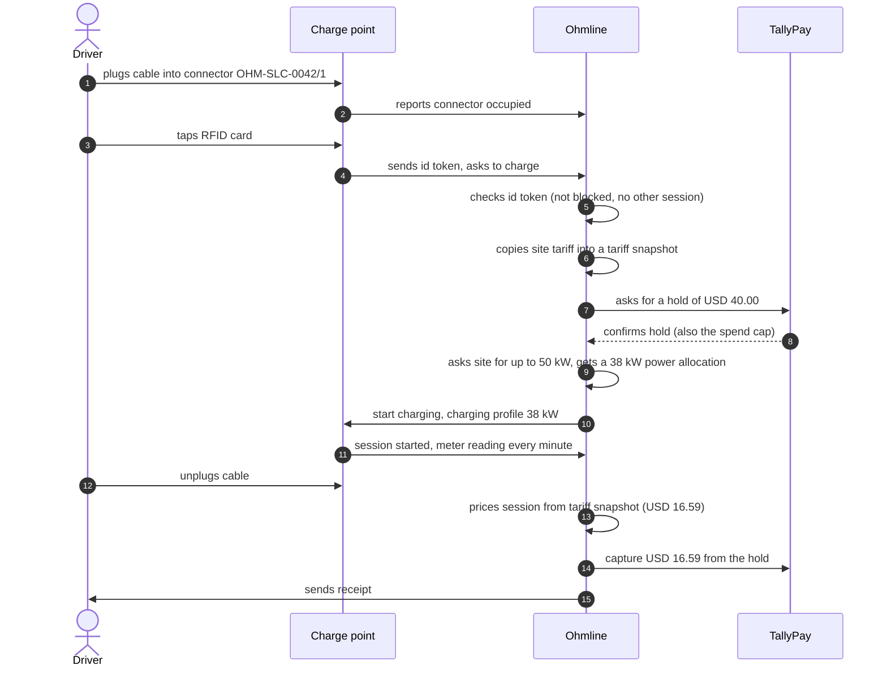

# Domain story 01: A driver charges with an RFID card

| | |
|---|---|
| Told by | The charging operations lead, with a regular driver at the depot |
| Granularity | Fine-grained: one charge, step by step |
| Point in time | As-is: how charging works today |
| Domain purity | Digitalized: Ohmline and the charge point appear as story actors |
| Site | `slc-depot`, connector `OHM-SLC-0042/1` |

A story actor is a person or a system role that does something in the story: the driver, the
charge point, Ohmline, TallyPay. It is **not** an Akka.NET actor. Some story actors will later be
served by Akka.NET actors and many will not; the story does not decide that.

## The story

1. The **driver** plugs the *cable* into *connector* `OHM-SLC-0042/1`.
2. The **charge point** reports to **Ohmline** that the *connector* is occupied.
3. The **driver** taps an *RFID card* on the **charge point**.
4. The **charge point** sends the card's *id token* to **Ohmline** and asks whether it may
   charge.
5. **Ohmline** checks the *id token*: it is not blocked and has no other *session* running.
6. **Ohmline** copies the site's current *tariff* into a *tariff snapshot* for the new
   *session*: USD 0.42 per kWh, a USD 1.00 session fee, and an idle fee of USD 0.40 per minute
   after a 15-minute grace period.
7. **Ohmline** asks **TallyPay** for a *hold* of USD 40.00 on the driver's *card*.
8. **TallyPay** confirms the *hold*. USD 40.00 is also the session's *spend cap*.
9. **Ohmline** asks the site for up to 50 kW for the *connector* and receives a *power
   allocation* of 38 kW, because four other cars are charging.
10. **Ohmline** tells the **charge point** to start charging with a *charging profile* of 38 kW.
11. The **charge point** starts the *session* and sends a *meter reading* every minute.
12. The **driver** unplugs the *cable*. The **charge point** reports that the *session* ended,
    with its final *meter reading*: 27.6 kWh delivered.
13. **Ohmline** prices the *session* from its *tariff snapshot*: a *price breakdown* of
    USD 16.59 in total.
14. **Ohmline** asks **TallyPay** to *capture* USD 16.59 from the *hold*; TallyPay releases the
    rest.
15. **Ohmline** sends the **driver** a *receipt*.

## The picture

The diagram is the pictographic form of the story. Each numbered arrow is one sentence above;
stick figures are people, boxes are system roles, and the arrow labels carry the work objects.

Arrow 12 shows only the driver unplugging; the charge point's report that the session ended
belongs to the same sentence of the story. Steps 5, 6, 9 and 13 are arrows
from Ohmline to itself, which is the first hint that "Ohmline" is not one thing. Checking a
token, locking a price, sharing the site's power and pricing a session are done by different
people in the company today, and the event-storming sessions split them apart.

## Work objects

Cable, connector, RFID card, id token, session, tariff, tariff snapshot, hold, card, spend cap,
power allocation, charging profile, meter reading, price breakdown, receipt.

## What the story taught us

- The driver says "start a charge", the charge point's protocol says "start a transaction" and
  the operations lead says "a session". They mean the same thing. The glossary settles on
  *charging session*.
- The price is fixed at step 6, before any energy flows. A tariff change during the session must
  not change this driver's price.
- Steps 3 to 10 happen while the driver stands at the charge point. They must finish within a
  few seconds.
- The power allocation at step 9 depends on every other car at the site, not on this driver.
