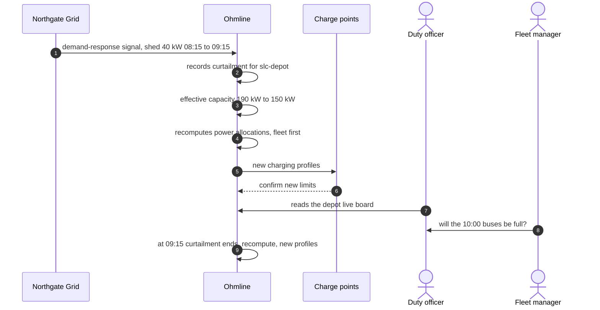

# Domain story 02: The grid operator curtails the bus depot

| | |
|---|---|
| Told by | The duty officer of Ohmline's network operations centre, with the depot's fleet manager |
| Granularity | Fine-grained: one curtailment at one site |
| Point in time | As-is |
| Domain purity | Digitalized: Northgate Grid, Ohmline and the charge points appear as story actors |
| Site | `slc-depot`: grid connection limit 200 kW, safety margin 10 kW |

A story actor is a person or a system role, not an Akka.NET actor.

## The story

At 08:10 five buses and one public car are charging at the depot.

1. **Northgate Grid** publishes a *demand-response signal*: site `slc-depot` must reduce its draw
   by 40 kW from 08:15 to 09:15.
2. **Ohmline** reads the *signal* and records a *curtailment* of 40 kW for the *site*.
3. At 08:15 **Ohmline** lowers the site's *effective capacity* from 190 kW to 150 kW (200 kW
   *grid connection limit*, minus 10 kW *safety margin*, minus 40 kW *curtailment*).
4. **Ohmline** recomputes every *power allocation* at the site. *Fleet* sessions are served
   first; the public car drops from 22 kW to the connector's minimum of 5 kW.
5. **Ohmline** sends each affected **charge point** a new *charging profile*.
6. Each **charge point** confirms its new limit.
7. The **duty officer** watches the depot's *live board*: capacity 150 kW, the sum of
   allocations 150 kW, every connector within its limits.
8. The **fleet manager** asks the **duty officer** whether the buses due out at 10:00 will be
   full. The **duty officer** reads the expected finish times from the *live board*.
9. At 09:15 the *curtailment* ends. **Ohmline** restores the effective capacity to 190 kW,
   recomputes the *power allocations* and sends new *charging profiles*.

## The picture

Arrow 8 is a conversation between two people that no system sees; it stays in the story because
it is why the live board must show expected finish times. Arrow 9 compresses three activities
into one line, to keep the picture small; the story above lists them.

## Work objects

Demand-response signal, curtailment, site, effective capacity, grid connection limit, safety
margin, power allocation, priority class (fleet, public), charging profile, live board.

## What the story taught us

- Northgate Grid *requests* a curtailment; Ohmline *applies* it. The grid operator's words
  ("event", "signal", "shed") are not Ohmline's words, and its message format is not Ohmline's
  model.
- The rule the depot lives by: the sum of all allocations never exceeds the effective capacity,
  and each allocation stays between its connector's minimum and maximum.
- Recomputing allocations is triggered by many things: a car arrives, a car leaves, a
  curtailment starts or ends. The operations lead calls it a *rebalance*; it has nothing to do
  with moving shards between servers.
- Fleet sessions have priority. Whether a public driver's price changes when their power drops
  is still an open question (see the Big Picture hotspots).
