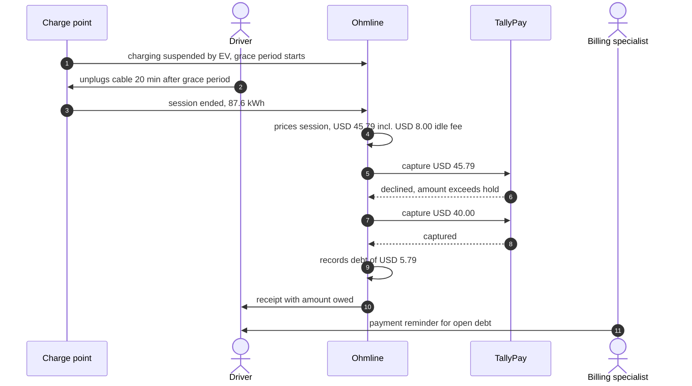

# Domain story 03: A payment fails after charging

| | |
|---|---|
| Told by | Ohmline's billing specialist, with the charging operations lead |
| Granularity | Fine-grained: the end of one session |
| Point in time | As-is |
| Domain purity | Digitalized: Ohmline, TallyPay and the charge point appear as story actors |
| Site | `slc-west-garage`, connector `OHM-SLC-0107/2` |

A story actor is a person or a system role, not an Akka.NET actor.

## The story

The driver started charging at 16:05. **TallyPay** holds USD 40.00 on the driver's card, which
is also the session's spend cap. The tariff snapshot is the one from story 01.

1. At 18:40 the car's battery is full and the car stops drawing power. The **charge point**
   reports that charging is *suspended by the EV*. The 15-minute *grace period* starts.
2. The **driver** comes back at 19:15 and unplugs the *cable*: 20 minutes after the grace
   period ended.
3. The **charge point** reports that the *session* ended, with its final *meter reading*:
   87.6 kWh delivered.
4. **Ohmline** prices the *session* from its *tariff snapshot*: USD 36.79 for energy, USD 1.00
   session fee and USD 8.00 *idle fee*, USD 45.79 in total.
5. **Ohmline** asks **TallyPay** to *capture* USD 45.79 from the *hold*.
6. **TallyPay** declines: the amount is larger than the *hold*.
7. **Ohmline** asks **TallyPay** to *capture* USD 40.00, the whole *hold*.
8. **TallyPay** confirms the *capture*.
9. **Ohmline** records a *debt* of USD 5.79 against the driver's account.
10. **Ohmline** sends the **driver** a *receipt* with the *price breakdown*, the amount paid and
    the amount still owed.
11. The next morning the **billing specialist** reviews the list of open *debts* and sends the
    **driver** a payment reminder.

## The picture

The story ends with a person, not a system. Every arrow before the last one happens within
seconds of the driver unplugging; the last one happens the next day, and nothing in Ohmline
today reminds the billing specialist to do it except a list.

## A variation: TallyPay does not answer

The billing specialist told a second version of the same story. At step 5 TallyPay does not
answer within 10 seconds. Ohmline asks again after 1 minute, 5 minutes and 30 minutes. If the
last attempt also fails, Ohmline records a debt for the whole amount and the billing specialist
follows it up the next morning. A capture that is asked for twice must never take the money
twice.

## Work objects

Grace period, idle fee, meter reading, session, tariff snapshot, price breakdown, hold, capture,
debt, receipt, payment reminder.

## What the story taught us

- The spend cap stops *charging* when the price reaches the hold, but it cannot stop the idle
  fee: the car may stay plugged in after charging ends. The price can therefore exceed the hold.
- Whether an idle fee applies depends on who stopped the charge. Here the EV stopped; had Ohmline
  paused the charge during a curtailment, the driver would not owe an idle fee.
- A failed capture is not an error to show the driver; it is a business situation with its own
  outcome: a debt.
- Retrying a capture is only safe if TallyPay recognises a repeated request.
