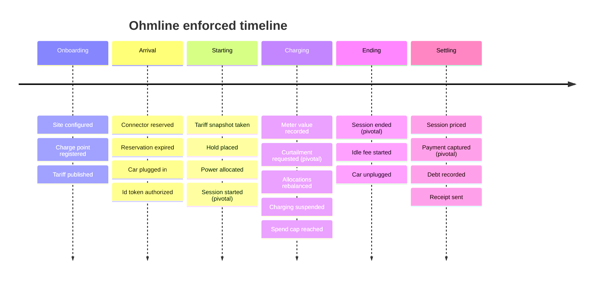
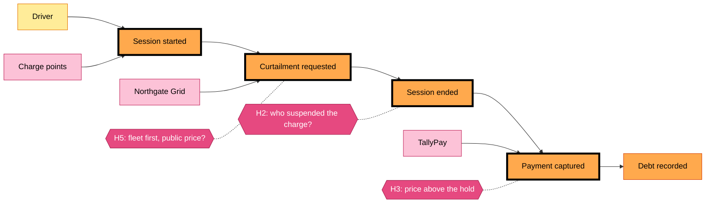

# Big Picture EventStorming: from an empty car park to a settled payment

| | |
|---|---|
| Scope | The whole business, from onboarding a site to settling a session |
| Who was in the room | Charging operations lead, duty officer, depot fleet manager, pricing analyst, billing specialist, two developers, a facilitator |
| Duration | Four hours, one long wall of paper |
| Input | Domain stories 01–03 (`docs/domain-stories/`) |

This file records the result of the session. It is the starting point for the process-level
boards (`process-start-charging.md`, `process-settle-session.md`) and the design-level board
(`design-level.md`).

## Colour legend

The same colours are used on every board in this folder. Big Picture uses only the first four
rows; the process and design levels add the rest.

| Sticky | Colour | Means | Written as |
|---|---|---|---|
| Domain event | Orange | Something that happened that a domain expert cares about | Past tense: "Session started" |
| Hotspot | Magenta, turned on its corner | A question, a conflict, a risk or a missing piece | A question or a warning |
| Person | Small yellow | A person or role who acts or decides | "Driver", "Duty officer" |
| External system | Large pink | A system Ohmline does not control | "TallyPay", "Northgate Grid" |
| Command | Blue | An intention: someone asks the system to do something | Imperative: "Reserve connector" |
| Policy | Lilac | A reaction: whenever *this* happens, then do *that* | "Whenever …, then …" |
| Read model | Green | The information a person needs to make a decision | A noun: "Site live board" |
| Aggregate | Large pale yellow | The thing that accepts or rejects a command and keeps a rule true | A domain noun: "Charge point" |

In the diagrams below, the colours are Mermaid class styles. A **pivotal event** has a thick
black border; on the wall it was marked with a vertical strip of tape.

## How the session ran

1. **Chaotic exploration.** Everyone wrote orange stickies for the things that happen in their
   work, in the past tense, without discussing them, and put them roughly where they belonged in
   time. About 120 stickies went up in 25 minutes, many of them duplicates.
2. **Enforcing the timeline.** The group merged duplicates, put the events in order from left
   to right, and argued wherever two people put the same event in different places. Most of the
   arguments became hotspots.
3. **Pivotal events.** The group picked the few events after which the business is in a
   different phase, and the people who care change. They split the timeline into phases.
4. **People and external systems.** Yellow and pink stickies were added under the events they
   cause or are told about.
5. **Hotspots and opportunities.** Each person got three dots to vote for the hotspots they
   would fix first.

## The timeline

The enforced timeline, read left to right, one column per phase. The phase names came from the
pivotal events that close each phase.

Each column holds the events of one phase, top to bottom in the order they usually happen.
"Connector faulted" and "Charge point went offline" were left out of the picture: they can
happen in every phase, and the group put them on a separate strip below the timeline.

## Pivotal events

| Pivotal event | What changes after it | Who cares |
|---|---|---|
| **Session started** | Energy flows, the price is locked and money is held. Undoing it now needs a refund or a void, not a cancel. | Driver, duty officer, billing specialist |
| **Curtailment requested** | The site must draw less power for a period it does not choose. Every running session at the site is affected. | Northgate Grid, duty officer, fleet manager |
| **Session ended** | No more energy flows. The connector is free for the next car; the session can now be priced. | Driver, pricing analyst, billing specialist |
| **Payment captured** | The money has moved. The session is closed for operations and becomes accounting history. | Billing specialist, driver |

The pivotal events, the external systems around them and the hotspots with the most votes:

Solid arrows follow the timeline; the driver and the charge points cause "Session started",
Northgate Grid causes "Curtailment requested", TallyPay reports "Payment captured". Dotted lines
attach a hotspot to the event it was found next to. "Curtailment requested" sits between start
and end because it happens *during* some sessions, not because every session has one.

## Hotspots

Votes are the dots each hotspot received. "Where it is answered" names the place in the sample
or the book that resolves it.

| # | Hotspot | Votes | Where it is answered |
|---|---|---|---|
| H1 | "Transaction", "charge" and "session" are used for the same thing, and "transaction" also means a payment. | 4 | Glossary, section 4.5 |
| H2 | Who suspended the charge? The idle fee must not apply when Ohmline paused charging during a curtailment. | 6 | Design level; the refactoring in section 8.6 |
| H3 | Idle fees can push the price above the hold (story 03). Who pays the difference? | 5 | Process level `settle a session`; debts in Billing |
| H4 | A charge point that was offline sends its meter readings late, out of order, or with a register that went backwards after a firmware reset. | 3 | Design level; `MeterAnomalyDetected` (section 7.7) |
| H5 | Fleet sessions are served first during a curtailment. Does a public driver whose power drops still pay the same rate? | 3 | Pricing analyst: yes, the tariff snapshot does not change (section 8.2) |
| H6 | A driver reserves a connector, then loses signal in the underground car park. The reservation expires while they park. | 2 | Driver app, Chapter 19 |
| H7 | The same RFID card is tapped at two sites within a minute. A cloned card, or two family members? | 2 | One active session per token; the `IdToken` aggregate (section 12.7) |
| H8 | TallyPay is slow or down when a session ends. How long do we retry, and can a retry take the money twice? | 4 | Process level `settle a session`; idempotency keys (section 15.6) |
| H9 | The tariff changes while a session is running. | 0 | Resolved in the room: the tariff snapshot taken at the start applies |
| H10 | Nobody knows which charge points the AssetTrack registry still lists by mistake. | 1 | Anticorruption layer for AssetTrack (sections 5.6 and 6.7) |

## People and external systems on the board

- **People:** driver, duty officer, depot fleet manager, pricing analyst, billing specialist,
  site owner.
- **External systems:** charge points (several vendors, a protocol in the style of OCPP 1.6J),
  TallyPay (payments), Northgate Grid (demand-response signals), AssetTrack (legacy asset
  registry).

## What the wall suggests about boundaries

The stickies were not evenly spread. Five clusters had their own vocabulary and their own
experts, and they line up with the bounded contexts drawn in Chapter 5:

- connectors, reservations and sessions (the operations lead): Charging;
- capacity, curtailment and allocations (the duty officer and the fleet manager): Site Energy;
- tariffs, bands and idle fees (the pricing analyst): Tariffs;
- cards and tokens: Driver Accounts;
- holds, captures, debts and receipts (the billing specialist): Billing.
