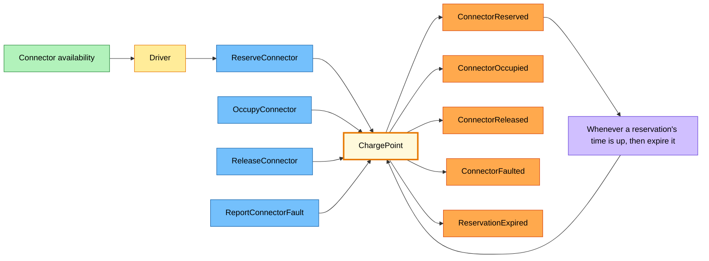

# Design-Level EventStorming: aggregates and the sticky-to-code map

| | |
|---|---|
| Scope | The commands and events of the two process boards, plus everything that happens to a connector |
| Who was in the room | Charging operations lead, duty officer, two developers, a facilitator |
| Starts at | `process-start-charging.md` and `process-settle-session.md` |
| Colours | The legend in `big-picture.md`; large pale yellow is an aggregate |

The process boards say *what* happens. The design-level board asks, for every blue command:
**who decides whether it is allowed, and what must that decider remember to decide it?** The
answer is a large yellow sticky placed between the command and its events: an aggregate. An
aggregate is the smallest thing that can keep one of Ohmline's rules true on its own.

## The aggregates that emerged

| Aggregate | The rule it keeps true | Keyed by | Shard type name (reserved) |
|---|---|---|---|
| Charge point | A connector hosts at most one session; a reserved connector accepts only the token that holds the reservation, until it expires | Charge point id, `OHM-SLC-0042` | `charge-point` |
| Charging session | Meter registers never go backwards; the price uses the tariff snapshot taken at the start; reaching the spend cap stops charging | Session id (Guid v7) | `charging-session` |
| Site power budget | The sum of allocations never exceeds the effective capacity; each allocation stays within its connector's minimum and maximum | Site id, `slc-depot` | `site-power-budget` |
| Id token | A token belongs to one account and has at most one active session | Token UID | `id-token` |

Each aggregate became a separate wall section because its rule needs only its own memory:

- **Charge point and charging session are separate.** A charge point lives for years and changes
  a few times a day; a session lives for an hour and records a meter value every minute. Putting
  sessions inside the charge point would make every meter value wait behind connector changes,
  and the charge point's history would grow without end.
- **The site power budget is one per site.** Its rule spans every connector at the site, so it
  cannot be split by charge point. At the bus depot it is the busiest decider in Ohmline; section
  15.8 measures whether one is enough.
- **The id token is its own aggregate** because "one active session per token" (hotspot H7) is a
  rule about the token, not about any charge point. Keying an aggregate on the token UID makes the
  rule a local check.

## The charge point board

The driver reads connector availability and reserves a connector. The charge point device (not
drawn) issues the other three commands as it reports what happens at the plug. The policy on the
right is triggered by time, not by a person: it sends `ExpireReservation` (not drawn, to keep the
board small) back to the same aggregate, which records `ReservationExpired`. Registration and the
two cancellation paths are in the table below.

The stickies now carry the names the code will use. Every command the charge point accepts, with
the event it records when it accepts it:

| Command (blue) | Event (orange) | From the board |
|---|---|---|
| `RegisterChargePoint` | `ChargePointRegistered` | Big Picture, *Onboarding* |
| `ReserveConnector` | `ConnectorReserved` | Driver reserves in the app |
| `CancelReservation` | `ReservationCancelled` | Driver changes their mind |
| `ExpireReservation` | `ReservationExpired` | Time-triggered policy |
| `OccupyConnector` | `ConnectorOccupied` | "Car plugged in" on the Big Picture |
| `ReleaseConnector` | `ConnectorReleased` | "Car unplugged" |
| `ReportConnectorFault` | `ConnectorFaulted` | The separate strip under the timeline |
| `ClearConnectorFault` | `ConnectorFaultCleared` | A technician repaired the connector |

## The other aggregates

| Aggregate | Commands | Events |
|---|---|---|
| Charging session | `StartSession`, `RecordMeterValue`, `SuspendCharging`, `ResumeCharging`, `StopSession` | `SessionStarted`, `MeterValueRecorded`, `MeterAnomalyDetected`, `ChargingSuspended`, `ChargingResumed`, `SpendCapReached`, `SessionEnded` |
| Site power budget | `ConfigureSite`, `RequestAllocation`, `ReleaseAllocation`, `ApplyCurtailment`, `EndCurtailment` | `SiteConfigured`, `AllocationGranted`, `AllocationQueued`, `AllocationsRebalanced`, `AllocationReleased`, `CurtailmentApplied`, `CurtailmentEnded` |
| Id token | `RegisterToken`, `BlockToken`, `LockForSession`, `UnlockFromSession` | `TokenRegistered`, `TokenBlocked`, `TokenLockedForSession`, `TokenUnlocked` |

Three things on these rows were argued about:

- `RecordMeterValue` can produce `MeterAnomalyDetected` instead of `MeterValueRecorded`. A
  register that went backwards (hotspot H4) is a fact the charger reported; the aggregate cannot
  refuse it, only record that it is wrong.
- `SpendCapReached` has no command of its own. The session records it when a meter value pushes
  the price to the cap, in the same decision as `MeterValueRecorded`.
- `ChargingSuspended` still carries hotspot H2: the idle fee depends on *who* suspended the
  charge. The group left the sticky as it is and wrote the question on it. Section 8.6 answers it.

## Stickies that did not become aggregates

Not every blue sticky found a yellow one:

- **"Price session"** needs no memory beyond the tariff snapshot and the meter readings, and it
  keeps no rule true over time. It became a pure calculation, a domain service in Tariffs
  (section 8.3), called by whoever needs a price.
- **"Place hold", "Capture payment" and "Void hold"** go to TallyPay. Ohmline's side of them is
  Billing, which stores holds and debts in tables and needs no aggregate in the actor sense
  (ADR 0004).
- **"Curtailment requested"** is Northgate Grid's event, on a pink sticky. Ohmline never stores
  it as its own fact. A translator turns the grid operator's signal into the command
  `ApplyCurtailment`, and the site power budget records `CurtailmentApplied` (section 16.8).
- **"Remote start"** is a message to a charge point device, sent through the Device Gateway in
  the device's own protocol (section 16.7).

## The sticky-to-code map

This table is the bridge from the wall to the sample. Every sticky colour has one kind of code,
in one kind of project.

| Sticky | Becomes | Lives in | Ohmline example | Section |
|---|---|---|---|---|
| Orange: domain event | A `sealed record` leaf of the aggregate's `closed record` event base, persisted in the journal | `*.Domain` | `ConnectorReserved : ChargePointEvent` | 4.6, 7.2 |
| Blue: command | A `sealed record` leaf of the aggregate's `closed record` command base | `*.Contracts` | `ReserveConnector : ChargePointCommand` | 4.6, 7.2 |
| Large yellow: aggregate | A pure decider (`Decide`, `Evolve`) hosted by a persistent entity actor in a shard region | `*.Domain` and `*.Actors` | `ChargePoint` in the region `charge-point` | 7.6, 10, 12 |
| Lilac: policy | A pure reaction, run by an event subscriber (choreography) or a process manager actor (orchestration) | `*.Domain/Policies`, `*.ReadModels`, `*.Actors` | `ReleaseOnSessionEnded`, `ChargingJourney` | 8.5, 15 |
| Lilac with a clock: time-triggered policy | An actor timer that sends a command to the aggregate | `*.Actors` | `ExpireReservation` | 11 |
| Green: read model | A projection that reads events from the journal and writes a table | `*.ReadModels` | `session-history-v1` | 13, 14 |
| Pink: external system | An anticorruption layer: a pure translator plus an adapter (an actor or an HTTP client) | `*.Acl.*`, Device Gateway, Billing | `GridSignalTranslator`, `TallyPayTranslator` | 6.7, 16 |
| Small yellow: person | A client of an HTTP endpoint or of the driver app | `*.Api`, `Ohmline.Mobile` | `POST /charge-points/{id}/connectors/{n}/reservations` | 12.5, 19 |
| Magenta: hotspot | An open question in a canvas, an ADR, or a test named after the rule | `docs/`, `tests/` | H2 becomes the refactoring in 8.6 | — |

Two consequences shape the rest of the sample:

- **Commands are in `Contracts`, events in `Domain`.** Other parts of Ohmline send an aggregate
  its commands: the Device Gateway sends `OccupyConnector` when a car is plugged in, the HTTP
  edge sends `ReserveConnector` for the driver app, and the charging journey sends commands to
  sessions. They may reference the commands. The events are the aggregate's own
  memory, and nothing outside its context reads them directly; what other contexts need is
  published separately (section 16.1).
- **The names on the wall are permanent.** The shard type names in the first table, and later
  the manifests of the events, end up in stored data. `docs/naming-rules.md` (section 4.5) lists
  them.
