# Process-Level EventStorming: settle a session

| | |
|---|---|
| Scope | From "session ended" to "receipt sent" (domain stories 01, steps 12–15, and 03) |
| Who was in the room | Billing specialist, pricing analyst, charging operations lead, two developers, a facilitator |
| Starts at | The Big Picture phases *Ending* and *Settling* (`big-picture.md`) |
| Colours | The legend in `big-picture.md` |

## The board

```mermaid
flowchart LR
    CP["Charge point"]:::external
    Pay["TallyPay"]:::external
    Ended["Session ended"]:::event
    P1["Whenever a session ends, then release its power"]:::policy
    Release["Release allocation"]:::command
    Released["Allocation released"]:::event
    P2["Whenever a session ends, then price it"]:::policy
    Price["Price session"]:::command
    Priced["Session priced"]:::event
    P3["Whenever a session is priced, then capture the payment"]:::policy
    Capture["Capture payment"]:::command
    Captured["Payment captured"]:::event
    Failed["Capture failed"]:::event
    P4["Whenever a capture fails for good, then record a debt"]:::policy
    Debt["Debt recorded"]:::event
    CP --> Ended
    Ended --> P1 --> Release --> Released
    Ended --> P2 --> Price --> Priced --> P3 --> Capture --> Pay
    Pay --> Captured
    Pay --> Failed --> P4 --> Debt
    classDef event fill:#ffa94d,stroke:#d9480f,color:#000
    classDef command fill:#74c0fc,stroke:#1864ab,color:#000
    classDef policy fill:#d0bfff,stroke:#6741d9,color:#000
    classDef external fill:#fcc2d7,stroke:#c2255c,color:#000
```

One event, "Session ended", starts two independent branches. Releasing the power must happen
within seconds, because other cars at the site are waiting for it. Pricing and capturing can
take longer, and may fail. Neither branch waits for the other, so they need not be one
transaction.

## Commands

| Command | Issued by | Expected event | Can fail because |
|---|---|---|---|
| Release allocation | Policy P1 | Allocation released | It cannot: releasing an allocation that is already released changes nothing |
| Unlock token | Policy P5 | Token unlocked | It cannot, for the same reason |
| Price session | Policy P2 | Session priced | It cannot: the tariff snapshot and the meter readings are all it needs |
| Capture payment | Policy P3, or a retry | Payment captured | TallyPay declines, or does not answer |
| Void hold | Policy P7 | Hold voided | TallyPay does not answer |

## Policies

| # | Whenever | Then | Notes |
|---|---|---|---|
| P1 | a session ends | release its power allocation | The site recomputes every other allocation (a *rebalance*) |
| P2 | a session ends | price it from its tariff snapshot and its meter readings | |
| P3 | a session is priced | capture the price from the hold | |
| P4 | a capture fails for good | record a debt for the amount not captured | Hotspot H3 |
| P5 | a session ends | unlock the token | The driver can start another session |
| P6 | the price is larger than the hold | capture the whole hold and record a debt for the rest | Story 03; a decline because of the amount counts as "fails for good" for the remainder |
| P7 | a session ends with no energy delivered | void the hold instead of capturing | Nobody pays for a session that never charged |
| P8 | TallyPay does not answer a capture | retry after 1, 5 and 30 minutes with the same idempotency key, then treat it as failed for good | Hotspot H8 |
| P9 | a payment is captured | send the driver a receipt | |

Policies P1, P2 and P5 react to the same event, and the billing specialist pointed out that none
of them needs to know about the others. P3, P4, P6 and P8 form a chain that has to remember how
many attempts it has made: that memory is what makes the chain a process rather than a set of
reactions (Chapter 15).

## Read models

| Read model | Who reads it | For which decision |
|---|---|---|
| Receipt | Driver | What they paid and what they still owe |
| Session history | Charging operations lead | Which sessions ended, how much energy each delivered |
| Open debts | Billing specialist | Whom to remind, the morning after |

## What the board taught us

- The event the business cares about is "Session ended", with its final meter reading. Whether
  the driver unplugged first or the charge point stopped first is a detail of the device.
- A failed capture is an event, not an exception: "Capture failed" has a policy of its own.
- A retry must not take the money twice, so every capture carries an idempotency key that
  TallyPay recognises (section 15.6).
- Policy P1 belongs to the site's power and P2 to pricing, but both start from Charging's
  "Session ended". That event is the most important fact Charging publishes to the rest of
  Ohmline.
