# Process-Level EventStorming: start charging

| | |
|---|---|
| Scope | From "car plugged in" to "session started" (domain story 01, steps 1–11) |
| Who was in the room | Charging operations lead, duty officer, billing specialist, two developers, a facilitator |
| Starts at | The Big Picture phases *Arrival* and *Starting* (`big-picture.md`) |
| Colours | The legend in `big-picture.md` |

A process-level board answers *how* the business moves from one event to the next. Every event
is caused by something: a command a person or a system issued, or a policy that reacts to an
earlier event. Every command needs the information to issue it: a read model.

The grammar of the board, read left to right:

```text
person or external system -> command -> event -> policy -> command -> event -> ...
read model -> person (who reads it before issuing the next command)
```

## The happy path

```mermaid
flowchart LR
    Driver["Driver"]:::person
    CP["Charge point"]:::external
    Pay["TallyPay"]:::external
    Occupied["Connector occupied"]:::event
    Lock["Lock token for session"]:::command
    Locked["Token locked for session"]:::event
    P1["Whenever a token is locked, then place a hold"]:::policy
    Hold["Place hold"]:::command
    Held["Hold placed"]:::event
    P2["Whenever a hold is placed, then request power"]:::policy
    Request["Request allocation"]:::command
    Allocated["Power allocated"]:::event
    P3["Whenever power is allocated, then start the charger"]:::policy
    Start["Remote start"]:::command
    Started["Session started"]:::event
    CP --> Occupied
    Driver -- taps card --> CP --> Lock --> Locked --> P1 --> Hold --> Pay --> Held
    Held --> P2 --> Request --> Allocated --> P3 --> Start --> CP
    CP --> Started
    classDef event fill:#ffa94d,stroke:#d9480f,color:#000
    classDef command fill:#74c0fc,stroke:#1864ab,color:#000
    classDef policy fill:#d0bfff,stroke:#6741d9,color:#000
    classDef external fill:#fcc2d7,stroke:#c2255c,color:#000
    classDef person fill:#ffec99,stroke:#e67700,color:#000
```



The driver does one thing: taps the card. Everything after "Token locked for session" is driven
by policies, and each policy issues a command to a different part of Ohmline or to an external
system: TallyPay for the hold, the site for power, the charge point to start. The charge point
appears twice on the wall, once as the source of "Connector occupied" and once as the target of
"Remote start"; Mermaid draws it once.

## Commands

| Command | Issued by | Expected event | Can be refused because |
|---|---|---|---|
| Lock token for session | Charge point, when the driver taps a card | Token locked for session | The token is blocked, or already has an active session |
| Place hold | Policy P1 | Hold placed | TallyPay declines the card |
| Request allocation | Policy P2 | Power allocated | Never refused; it may be queued when the site has no capacity left |
| Remote start | Policy P3 | Session started | The charge point rejects it or does not answer |

## Policies

| # | Whenever | Then | Notes |
|---|---|---|---|
| P1 | a token is locked for a session on an occupied connector | place a hold for the site's default spend cap | The spend cap is USD 40.00 for public drivers |
| P2 | a hold is placed | request power for the connector, up to its maximum | |
| P3 | power is allocated | send the charge point a remote start with a charging profile of the allocated power | The tariff snapshot is taken here, from the *current site tariff* read model |
| P4 | the token lock is refused | show "card not accepted" on the charge point | No hold is placed |
| P5 | a hold is declined | unlock the token and show "payment declined" | |
| P6 | the session has not started 60 s after the remote start | release the allocation, void the hold and unlock the token | A time-triggered policy: the clock is the trigger |

P4 to P6 are the unhappy paths. Each of them undoes some of what the earlier policies did, and
the undo steps are business decisions: voiding a hold is not the same as never placing it,
because the driver's bank shows both.

## Read models

| Read model | Who reads it | For which decision |
|---|---|---|
| Connector availability | Driver (map in the app, light on the charge point) | Which connector to drive to and plug into |
| Current site tariff | Policy P3 | Which tariff to copy into the session's tariff snapshot |
| Session card | Driver (app, charge point display) | Whether charging has started and at what power |
| Site live board | Duty officer | Whether the site is within its effective capacity |

## What the board taught us

- "Start charging" is not one step. It is a chain of four commands to four different owners,
  held together by policies and a deadline. Section 15.2 turns this chain into the charging
  journey, a process manager.
- The order of P1 and P2 is a business choice: Ohmline holds the money before it commits power,
  so that a declined card never takes power away from other cars at the site.
- The tariff snapshot is taken from a read model that may be a few seconds old. The pricing
  analyst accepted that: a tariff change takes effect for sessions that start after it is
  visible, not at the exact second it is published.
