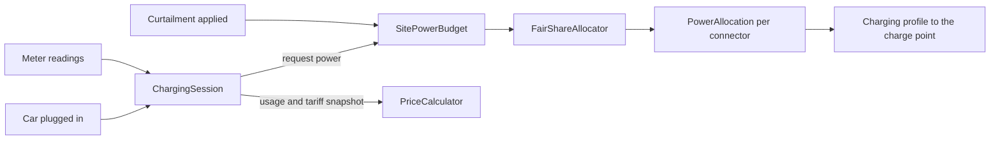

# The highlighted core

*A distillation document, written in section 5.8. The domain vision statement
(`docs/vision.md`) says why the core matters; this page says where it is, so that a newcomer
can find the few hundred lines that decide whether Ohmline succeeds.*

Ohmline's core domain is **site power allocation** and the **charging session** that uses the
power it allocates (`docs/subdomains.md`). Everything in this page is about those two; everything
else in the sample serves them.

## The core in one picture

Two aggregates and one mechanism decide almost everything that sets Ohmline apart.

A session asks the site power budget for power. The budget runs the fair-share allocator over
every request at the site, within the effective capacity that the grid connection limit, any
curtailment and the safety margin leave, and grants each connector a power allocation. The
allocation reaches the charge point as a charging profile. Meter readings flow back into the
session, and when it ends, the price calculator turns its usage and its tariff snapshot into a
price breakdown.

## Flagged core

These are the core's model elements. They are reviewed by two people, need a test for every rule
they keep, and are the first place to look when a site misbehaves. Each lives in a `Domain`
project, so it is pure (section 5.3).

| Element | Where (from the section named) | Section |
|---|---|---|
| `SitePowerBudget` decider: the sum of allocations never exceeds the effective capacity | `Ohmline.SiteEnergy.Domain/Budgets` | 7.8 |
| `PowerAllocation`, `PriorityClass`, `AllocationDecision` | `Ohmline.SiteEnergy.Domain/Budgets` | 7.8 |
| `FairShareAllocator.Allocate`: water-filling, fleet first | `Ohmline.SiteEnergy.Domain/Budgets` | 7.8 |
| `ChargingSession` decider and `SessionState`: monotonic meters, tariff snapshot, spend cap | `Ohmline.Charging.Domain/Sessions` | 7.7 |
| `MeterReading` and its anomalies | `Ohmline.Charging.Domain/Metering` | 6.5 |
| Who suspended the charge (by the car or by Ohmline) | `Ohmline.Charging.Domain/Sessions` | 8.6 |
| The invariants as property tests | `tests/Ohmline.SiteEnergy.Domain.Tests`, `tests/Ohmline.Charging.Domain.Tests` | 9.4 |

The charge point aggregate, the charging journey and the read models are important, but they
are not on this list: they are where a core decision is recorded, coordinated or shown, not
where it is made.

## Distillation, pattern by pattern

Evans names seven distillation patterns. This is how each one appears in Ohmline.

| Pattern | In Ohmline |
|---|---|
| **Core Domain** | Site power allocation and charging sessions. They get the event-sourced deciders, the property tests and the most experienced people (ADR 0004) |
| **Generic Subdomains** | Card payments (TallyPay), grid demand response (Northgate Grid), the asset registry (AssetTrack), accounting and roaming: bought or integrated, each behind an anticorruption layer, none of them modeled in depth (`docs/context-map.md`) |
| **Domain Vision Statement** | `docs/vision.md`: one page on what the core is and why it matters, and on what is deliberately not core |
| **Highlighted Core** | This page, as a distillation document, and the flagged-core table above |
| **Cohesive Mechanisms** | The `FairShareAllocator` (Site Energy) and the `PriceCalculator` (Tariffs, section 8.3): algorithms with a narrow, intention-revealing interface, pure functions called from a decider with the data they need. The decider says *what* is decided; the mechanism says *how* the numbers come out |
| **Segregated Core** | Each context's `Domain` project holds only its model, separated from actors, persistence and HTTP, and the build enforces it (`build/DomainPurity.targets`, `tests/Ohmline.ArchitectureTests`). Within Site Energy, the allocator and the budget are segregated from the ACLs that feed them (`Ohmline.SiteEnergy.Acl.*`) |
| **Abstract Core** | The few abstractions every core model is written against, in the shared kernel: `IDecider` (section 7.6), `Result<T, E>`, `IValueObject<TSelf, TValue>`, the units and identifiers. Every context's model, and the actor shell that hosts it, depend on these, not on each other |

## Keeping the core small

- A new rule goes into the core only if it changes how power is shared or how a session is
  decided. A rule about how something is shown, stored or sent goes into a read model, the
  shell or an ACL.
- A mechanism that grows a second user (a second kind of allocation, a second price) is a
  candidate for its own Cohesive Mechanism, not a branch inside a decider.
- When the core changes, the vision statement is reread. If the change does not serve it, the
  change is in the wrong place.
