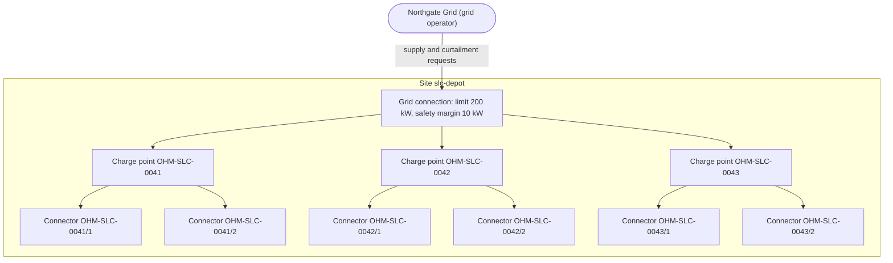

# Ohmline domain primer

Ohmline is a fictional charge point operator (CPO). It runs about 300 charging sites: public car
parks, workplaces and one bus depot. Drivers start a charge with an RFID card or with the driver
app, and Ohmline has to keep three promises at once:

- keep every site within the power its grid connection allows, less whatever the grid operator
  has asked it to give back;
- price every charging session from the tariff that applied when the session started;
- take payment as a hold on the driver's card that is later captured for the final amount or
  released.

This primer introduces the vocabulary by following one charge from plug-in to receipt. The terms
in *italics* are part of the ubiquitous language; `docs/glossary.md` defines the most important
of them and grows with the book.

## One site

A *site* is a location with one *grid connection* and therefore one power budget. The diagram
shows the site `slc-depot`: a grid connection with three *charge points*, each with two numbered
*connectors*.

Power flows from the grid operator through the site's single connection to the three charge
points, and from each charge point to whichever of its two connectors has a car plugged in. Each
connector can deliver between 5 kW and 50 kW, so six cars charging at full speed would ask for
300 kW. The connection allows 200 kW, and Ohmline keeps a *safety margin* of 10 kW below that,
which leaves an *effective capacity* of 190 kW to share. Sharing it fairly, and recomputing the
shares whenever something changes, is the hardest problem in the domain.

## One charge, end to end

A driver arrives at the depot at 07:52 with 15% battery and a weekday meeting at 09:00.

| Step | What happens | Who decides |
|---|---|---|
| 1. Plug in | The driver plugs into connector `OHM-SLC-0042/1`. The charge point reports that the connector is no longer *Available*. | Charging |
| 2. Tap the card | The driver taps an RFID card. The charge point sends the card's *id token* to Ohmline and asks whether it may charge. | Driver Accounts |
| 3. Lock the price | Ohmline copies the current *tariff* of the site into a *tariff snapshot*: USD 0.42 per kWh, a USD 1.00 session fee, and an *idle fee* of USD 0.40 per minute after a 15-minute *grace period*. Later tariff changes never touch this session. | Tariffs, Charging |
| 4. Hold the money | Ohmline asks TallyPay, the payment provider, for a *hold* of USD 40.00 on the driver's card. That amount is also the session's *spend cap*. | Billing |
| 5. Ask for power | The connector asks the site for up to 50 kW. Four other cars are charging, so the *fair-share allocation* grants 38 kW, and Ohmline sends the charge point a *charging profile* with that limit. | Site Energy |
| 6. Charge | The *charging session* starts. Every minute the charge point sends a *meter reading*: its cumulative energy register in Wh, which must never go backwards. | Charging |
| 7. Give power back | At 08:15 Northgate Grid asks the site to shed 40 kW for an hour. That *curtailment* lowers the effective capacity to 150 kW, every allocation is recomputed, and this connector drops to 30 kW. | Site Energy |
| 8. Stop charging | At 08:40 the car is full and stops drawing power: the session is *suspended by the EV*, not by Ohmline. The grace period starts. | Charging |
| 9. Unplug | The driver unplugs at 09:05, ten minutes after the grace period ended. The session ends with 27.6 kWh of *energy delivered*. | Charging |
| 10. Price it | The *price breakdown*: 27.6 kWh at USD 0.42 is USD 11.59 after rounding, plus the USD 1.00 session fee, plus ten idle minutes at USD 0.40, for USD 16.59 in total. | Tariffs |
| 11. Settle | Ohmline *captures* USD 16.59 from the hold; the rest of the hold is released, and the driver gets a *receipt*. | Billing |

Steps 2 to 5 must complete in a few seconds while the driver watches the charge point's display.
Steps 6 to 9 can take minutes or hours. Step 11 may happen long after the driver has left, and it
may fail and need a retry or end as a *debt*.

## The rules that must hold

These are the invariants the sample enforces. Each one belongs to exactly one part of the system.

- A connector hosts at most one session at a time.
- A reserved connector accepts only the token that holds the reservation, until the reservation
  expires.
- Meter registers never go backwards.
- A session is priced with the tariff snapshot taken at its start, and reaching the spend cap stops
  the session.
- At every site, the sum of all power allocations never exceeds the grid connection limit minus
  active curtailment minus the safety margin, and each allocation stays within its connector's
  minimum and maximum.

## Where the words live

The same words mean different things in different parts of Ohmline, so the sample splits the
domain into bounded contexts. Chapter 5 of the book draws the full context map.

| Context | Cares about |
|---|---|
| Charging | Charge points, connectors, reservations and charging sessions |
| Site Energy | Grid connection limits, curtailment and power allocations per site |
| Tariffs | Tariffs, time-of-use bands, idle fees and price breakdowns |
| Driver Accounts | Id tokens and which driver they belong to |
| Billing | Holds, captures, voids, debts and receipts |
| Device Gateway | Talking to charge points in their own protocol |
| Driver App | The driver's phone: pending commands, offline use, a local copy of read models |

The charger protocol in the sample is a simplified subset in the style of OCPP 1.6J. OCPP calls a
charging session a "transaction"; inside Ohmline the word is always *session*.

## Why this domain

Online shops are the usual teaching domain, but their rules are mostly about data entry, and their
concurrency problems rarely show up in a book-sized example. Charging is different:

- **The invariants are quantitative.** "The site may draw at most 190 kW" is checked against
  numbers that change every second, not against a status field.
- **Time is everywhere.** Reservations expire, grace periods end, time-of-use bands follow
  site-local time across daylight-saving changes, heartbeats time out and payment holds lapse.
- **The devices behave like actors.** Charge points are long-lived, connected, send messages
  whenever they like and must be answered one at a time. Sessions, sites and tokens are each a
  natural single writer.
- **Every external system is awkward in its own way.** Charger protocol frames, a payment
  provider with an unfriendly API, grid demand-response signals and a legacy CSV registry each
  need a different kind of translation.
- **There is a real edge client.** Drivers stand in underground car parks with no signal, so
  offline commands, idempotency and eventual consistency stop being abstract.

Every company named here is fictional: Ohmline, TallyPay, Northgate Grid and AssetTrack.
