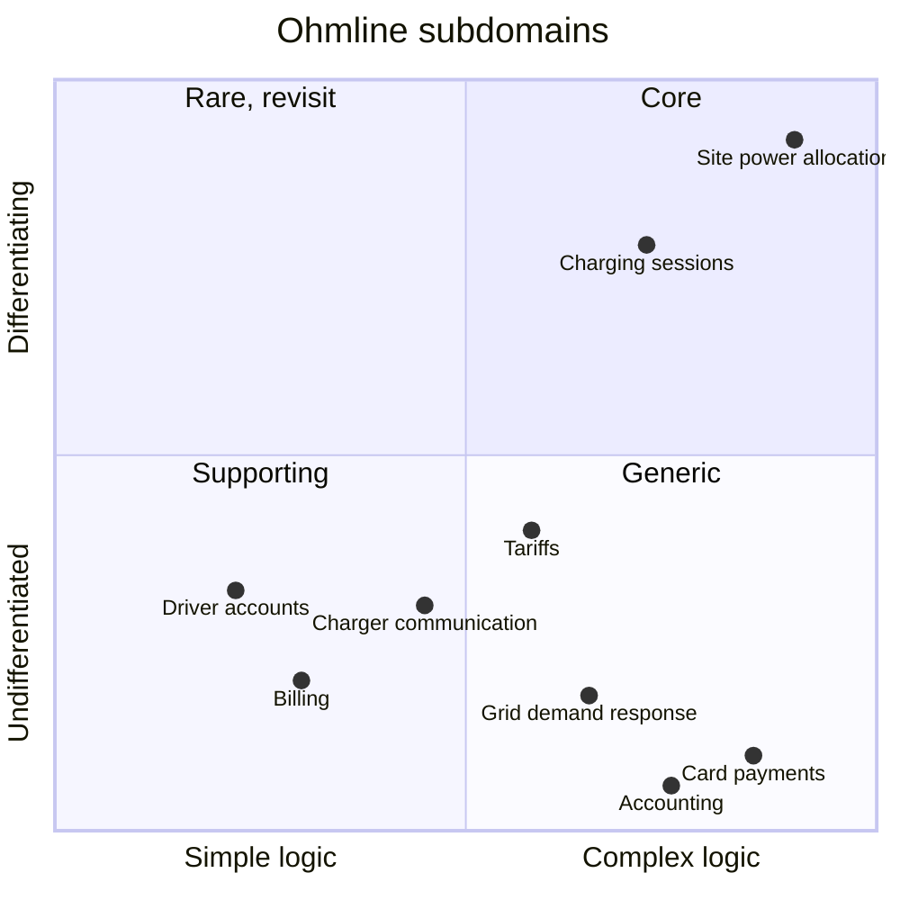

# Ohmline's subdomains

A subdomain is a part of what Ohmline *does* as a business, whether or not any software exists
for it. This page classifies each one, because the classification decides where Ohmline spends
its best people and its most careful modeling, and where it buys or keeps things simple.
Bounded contexts (Chapter 5) are the software boundaries drawn around these; the two are related
but not the same.

## The classification

| Subdomain | Type | Evolution stage | Build or buy | Business-model role | Rationale |
|---|---|---|---|---|---|
| Site power allocation | **Core** | Custom built | Build | Revenue generator | The reason a site owner chooses Ohmline: more chargers on the same grid connection, never over the limit. Complex, changes often, and no product fits Ohmline's mix of sites |
| Charging session management | **Core** | Custom built | Build | Revenue generator, engagement creator | Every operator has sessions, but Ohmline's are tied to the power budget, the spend cap and offline charge points. Getting them right is what drivers trust |
| Tariffs and pricing | Supporting | Custom built | Build, small | Revenue generator | Prices must be exact, and the rules change monthly, but they are rules as data rather than a competitive edge |
| Driver accounts and tokens | Supporting | Product | Build, small | Engagement creator | A small set of rules (one active session per token, blocked cards); a customer platform would do more than needed |
| Billing and receipts | Supporting | Product | Build, simple | Compliance enforcer | Must be correct and auditable, but it is bookkeeping: record a hold, a capture, a debt, a receipt |
| Charger communication | Supporting | Product | Build a thin translator | Cost reducer | Every vendor speaks a slightly different dialect of the protocol. A gateway product exists, but Ohmline needs control over vendor quirks |
| Card payments | Generic | Commodity | Buy (TallyPay) | — | Solved, regulated and risky to build. TallyPay does it |
| Grid demand response | Generic | Product | Integrate (Northgate Grid) | Compliance enforcer | Northgate Grid defines the signals; Ohmline only has to understand them |
| Asset registry | Generic | Product | Already bought (AssetTrack) | Cost reducer | A legacy system Ohmline cannot replace yet; its data is translated at the boundary |
| Accounting and ledger | Generic | Commodity | Buy | Compliance enforcer | Finance uses an off-the-shelf package; Billing exports to it |
| Roaming with other operators | Generic | Product | Integrate (a roaming hub) | Engagement creator | Ohmline follows the hub's protocol as it is |

The columns:

- **Type** follows Evans and Vernon: *core* is where Ohmline wins or loses against competitors,
  *supporting* is necessary and specific to Ohmline but not a differentiator, *generic* is a
  problem everybody has and somebody has already solved.
- **Evolution stage** is Simon Wardley's: genesis, custom built, product (or rental), commodity.
  It says how well understood a capability is in the market, not how good Ohmline's version is.
- **Business-model role** comes from the Bounded Context Canvas: does the subdomain earn money
  (revenue generator), keep drivers and site owners coming back (engagement creator), keep
  Ohmline within the law and its contracts (compliance enforcer) or save money (cost reducer)?

## The heuristics, applied

Vlad Khononov gives four questions. The borderline cases were decided like this:

| Question | Site power allocation | Tariffs | Charger communication |
|---|---|---|---|
| Does it give a competitive advantage? | Yes: site owners choose Ohmline for it | No: drivers compare prices, not tariff engines | No: drivers never see it |
| Is the logic complex? | Yes: a water-filling allocation under a moving limit, recomputed within seconds | Moderately: time-of-use bands across daylight-saving changes, caps, rounding | Moderately: many small vendor quirks, little logic |
| Is it volatile? | Yes: new site types, new grid programmes, fleet contracts | Yes, but as data: the pricing analyst edits tariffs, not code | Slowly: new firmware, new vendors |
| Could Ohmline buy it? | No product fits | Partly: billing platforms price sessions, but not with Ohmline's snapshot rule | Yes, but it would hide the quirks Ohmline must handle |

Tariffs scored "complex" and "volatile", which are two of the signs of a core subdomain. They
stay supporting because the volatility is in the *data*, not in the model: a new tariff is a new
row, not a new rule. Section 8.2 builds them as a Knowledge Level for exactly that reason.

## Complexity against differentiation

The same classification as a picture, after Khononov's chart: how complex the business logic is
against how much it sets Ohmline apart.

Top right is core: complex and differentiating. Bottom left is supporting: simple and specific
to Ohmline. Bottom right is generic: complex, but the same for everybody, so it is bought. The
top-left quadrant would hold something simple that still sets Ohmline apart; nothing sits there
today, and if something did, it would be a sign that a competitor could copy it quickly.

## Why site power allocation is the differentiator

At most of Ohmline's sites, power is scarcer than chargers. A car park whose grid connection
could run four chargers at full speed hosts six or ten, and the site owner pays for that
connection, not for the chargers. Ohmline's allocation decides, many times a minute, how the
effective capacity is shared: fleet before public, every connector between its minimum and
maximum, never above the grid connection limit minus curtailment minus the safety margin. Doing
this well is what lets a site owner install more chargers without a new grid connection, and it
is the part of Ohmline that competitors cannot buy.

That is why Site Energy gets the most careful model in the sample (sections 7.8 and 9.4), why the
allocator is a separate, pure Cohesive Mechanism, and why the domain vision statement
(`docs/vision.md`) leads with it.

## What the classification does not decide

- **Which bounded contexts exist.** One subdomain can need several contexts, and one context can
  serve several subdomains. Charging session management and charger communication meet in two
  contexts (Charging and the Device Gateway) that work as a partnership.
- **How each subdomain is implemented.** That follows from the classification but is a separate
  decision: ADR 0004 (`docs/adr/0004-implementation-style-per-subdomain.md`).
- **Forever.** Core subdomains drift towards supporting as the market catches up. The table is
  reviewed whenever Ohmline's strategy changes.
